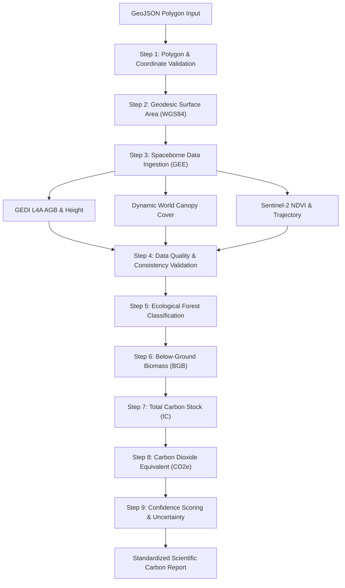

# CanopyAI Scientific Methodology & Algorithmic Architecture

**A Remote Sensing Framework for Above-Ground Biomass, Carbon Storage, and Uncertainty Quantification**

---

## 1. Overview

CanopyAI is an automated cloud-native remote sensing engine that quantifies forest above-ground biomass, below-ground biomass, and carbon dioxide equivalent ($\text{CO}_2\text{e}$) storage for user-defined geographic polygons. By fusing spaceborne waveform LiDAR from NASA's Global Ecosystem Dynamics Investigation (GEDI L4A) with high-resolution optical imagery from ESA Sentinel-2 and near real-time deep-learning land cover classifications from Google Dynamic World and ESA WorldCover, CanopyAI delivers transparent, screening-level forest carbon estimates in under 30 seconds without requiring destructive on-site forest inventory plots.

---

## 2. Spaceborne Data Sources

### 2.1 NASA GEDI L4A (Footprint-Level Aboveground Biomass Density)
- **What it Measures**: Aboveground Biomass Density (AGBD, in $\text{Mg/ha}$ or metric tonnes per hectare) and vertical canopy profile metrics ($RH_{98}$, tree canopy height).
- **Sensor Type**: Active spaceborne waveform LiDAR operating at $1064\text{ nm}$ mounted on the International Space Station (ISS).
- **Spatial Resolution**: $25\text{ m}$ circular ground footprints sampled along 8 ground tracks spaced $\sim 600\text{ m}$ cross-track.
- **Temporal Coverage**: April 2019 to early 2023.
- **Processing in CanopyAI**:
  - Filtered by footprint quality flags (`quality_flag == 1`, `degradation_flag == 0`).
  - Strict physical bounds checking: $0.0 \le \text{AGBD} \le 1000.0\text{ Mg/ha}$ and $0.0 \le RH_{98} \le 120.0\text{ m}$.
  - Spatial aggregation via Google Earth Engine `reduceRegion` using mean, standard deviation, and sample count ($n$).
- **Known Limitations**:
  - Orbital inclination limits coverage to latitudes between $51.6^\circ\text{ N}$ and $51.6^\circ\text{ S}$; high boreal and arctic regions cannot be sampled directly by GEDI.
  - LiDAR signal attenuates under dense cloud cover; steep terrain slopes ($> 20^\circ$) broaden waveform returns and increase height uncertainty.

### 2.2 ESA Sentinel-2 MSI (Multispectral Instrument)
- **What it Measures**: Top-of-Atmosphere (TOA) and Bottom-of-Atmosphere (BOA) surface reflectance across 13 spectral bands, notably Band 4 (Red, $665\text{ nm}$) and Band 8 (Near-Infrared / NIR, $842\text{ nm}$).
- **Spatial Resolution**: $10\text{ m}$ (visible and NIR bands).
- **Temporal Coverage**: 2015 – Present with a 5-day revisit cadence (constellation of Sentinel-2A and 2B).
- **Processing in CanopyAI**:
  - Cloud and shadow masking using QA60 and Scene Classification Layer (SCL) bitmasks.
  - Calculation of Normalized Difference Vegetation Index:
    $$\text{NDVI} = \frac{\text{NIR} - \text{Red}}{\text{NIR} + \text{Red}} = \frac{B_8 - B_4}{B_8 + B_4}$$
  - Multi-year seasonal composite trajectory tracking (5-year rolling median) to evaluate vegetation stability and detect forest clearing.
- **Known Limitations**: Persistent tropical cloud decks can obscure ground observations for weeks or months during rainy seasons.

### 2.3 Google Dynamic World (v1)
- **What it Measures**: Near real-time pixel-level probability distribution across 9 land cover classes:
  1. Water (`0`)
  2. Trees (`1`)
  3. Grass (`2`)
  4. Flooded vegetation (`3`)
  5. Crops (`4`)
  6. Shrub and scrub (`5`)
  7. Built area (`6`)
  8. Bare ground (`7`)
  9. Snow and ice (`8`)
- **Spatial Resolution**: $10\text{ m}$ resolution mapped globally.
- **Processing in CanopyAI**:
  - Tree canopy cover fraction calculation:
    $$\text{Canopy Cover (\%)} = \left( \frac{\text{Pixel Count}_{\text{Trees}}}{\text{Total Valid Pixels}} \right) \times 100\%$$
  - Class composition histogram extraction to detect non-forest edge cases (water bodies, urban centers, agricultural monocultures, and bare ground).
- **Known Limitations**: Deep learning model occasionally confuses young agroforestry tree plantations or orchard crops with natural tree cover.

### 2.4 ESA WorldCover 2021 (v200)
- **What it Measures**: Global discrete land cover map at $10\text{ m}$ resolution based on both Sentinel-1 SAR and Sentinel-2 optical data.
- **Use in CanopyAI**: Provides secondary cross-validation for biome boundaries and baseline land cover classification.

---

## 3. End-to-End Calculation Pipeline

The CanopyAI processing pipeline executes a deterministic, scientifically validated sequence:

### Step 1: Polygon Geometric & Topological Validation
- Validates GeoJSON structure (WGS84 / EPSG:4326), ring orientation, closure (first == last coordinate), and lack of self-intersections using `app.utils.geo.validate_polygon`.

### Step 2: Geodesic Area Calculation
- Computes true ellipsoidal surface area in hectares ($ha$) using the Karney geodesic polygon algorithm on the WGS84 ellipsoid (`pyproj.Geod`):
  $$1\text{ ha} = 10,000\text{ m}^2$$
- Enforces platform operating boundaries ($10\text{ ha} \le \text{Area} \le 100,000\text{ ha}$).

### Step 3: Satellite Data Extraction & Bound Checking
- Ingests GEDI LiDAR shots, Sentinel-2 imagery, and Dynamic World composites.
- Rejects non-physical observations:
  - $\text{AGBD} < 0\text{ Mg/ha}$ or $> 1000\text{ Mg/ha}$
  - Canopy Height $< 0\text{ m}$ or $> 120\text{ m}$
  - $\text{NDVI} < -0.2$ or $> 1.0$
  - Canopy Cover $< 0.0\%$ or $> 100.0\%$

### Step 4: Consistency & Cross-Validation Checks
1. **Biomass vs. Canopy Cover**: Flags high biomass ($> 100\text{ Mg/ha}$) with low canopy cover ($< 20\%$).
2. **NDVI vs. Canopy Cover**: Flags high greenness ($\text{NDVI} > 0.6$) with sparse canopy ($< 15\%$) as agricultural crops or herbaceous understory.
3. **Canopy Height vs. Biomass**: Flags tall trees ($> 25\text{ m}$) with low biomass ($< 30\text{ Mg/ha}$) as degraded stands.
4. **Water Contradiction**: Flags negative NDVI ($< 0.0$) with high biomass ($> 50\text{ Mg/ha}$) as water contamination.

### Step 5: Forest Type Classification
- Classifies forest biomes into primary IPCC ecozones:
  - **Tropical Moist Broadleaf Forest** (Amazon, Congo, Southeast Asia, Western Ghats)
  - **Temperate Broadleaf & Mixed Forest** (Central Europe, North America)
  - **Boreal Coniferous Forest / Taiga** (Scandinavia, Siberia, Canada)
  - **Non-Forest** (Water, Desert, Urban, Cropland)

### Step 6: Below-Ground Biomass (BGB) Calculation
- Applies empirical root-to-shoot ($R$) allometric expansion factors according to IPCC guidelines:
  $$\text{BGB} = \text{AGB} \times R$$
  where default IPCC Tier 1 ratios are:
  - Tropical Moist Broadleaf: $R = 0.21$
  - Temperate Broadleaf & Mixed: $R = 0.26$
  - Boreal Coniferous: $R = 0.24$
  - Non-Forest / Zero Biomass: $R = 0.0$

### Step 7: Total Biomass & Carbon Stock Calculation
- Total living biomass:
  $$\text{Total Biomass} = \text{AGB} + \text{BGB}$$
- Total carbon stock density ($tC/\text{ha}$) using the universal IPCC carbon fraction:
  $$\text{Carbon Stock} = \text{Total Biomass} \times 0.47$$
  *(IPCC Tier 1 default carbon fraction for dry wood biomass).*

### Step 8: Carbon Dioxide Equivalent ($\text{CO}_2\text{e}$) Calculation
- Converts elemental carbon to equivalent atmospheric $\text{CO}_2$ using the stoichiometric molecular weight ratio of carbon dioxide ($\text{CO}_2$, $44.01\text{ g/mol}$) to carbon ($C$, $12.011\text{ g/mol}$):
  $$\text{CO}_2\text{e} = \text{Carbon Stock} \times \left( \frac{44}{12} \right) \approx \text{Carbon Stock} \times 3.6667$$
- Landscape total carbon storage across the polygon:
  $$\text{Total }\text{CO}_2\text{e (tonnes)} = \text{CO}_2\text{e (t/ha)} \times \text{Area (ha)}$$

### Step 9: Confidence Scoring & Uncertainty Estimation
- Computes standard error and the 95% Confidence Interval for AGB observations:
  $$CI_{95\%} = 1.96 \times \left( \frac{\sigma}{\sqrt{n}} \right)$$
  $$CI_{\%} = \left( \frac{CI_{95\%}}{\mu_{\text{AGB}}} \right) \times 100\%$$
- Multi-factor heuristic data quality index ($0\text{--}100$) evaluating:
  - GEDI footprint sample density ($n \ge 20$: sufficient; $n < 5$: high penalty)
  - Coefficient of variation ($CV = \sigma / \mu > 0.5$: heterogenous penalty)
  - Cloud cover contamination ($> 30\%$: penalty)
  - Boundary edge effects & polygon scale
  - Class alignment and ecoregion consistency

---

## 4. Methodological Assumptions & IPCC Alignment

1. **Carbon Fraction of Dry Biomass ($CF = 0.47$)**:
   - Standard IPCC 2006 Guidelines for National Greenhouse Gas Inventories (Volume 4: AFOLU, Chapter 4: Forest Land). While species-specific fractions range from $0.46$ to $0.50$, $0.47$ represents the pantropical and temperate standard for Tier 1 accounting.
2. **Root-to-Shoot Ratios ($R = 0.21\text{--}0.26$)**:
   - Sourced from IPCC Table 4.4 (Default values for root-to-shoot ratios for forest types). In situations where local root-coring data is absent, Tier 1 ecozone averages are applied.
3. **GEDI Parametric Models**:
   - Assumes NASA GEDI L4A Footprint Biomass model (Dubayah et al., 2022) is calibrated for closed canopy systems within the $\pm 51.6^\circ$ latitude zone.
4. **Soil and Dead Organic Matter Exclusions**:
   - CanopyAI explicitly restricts calculations to living above-ground and below-ground tree biomass. Soil organic carbon (SOC), leaf litter, and coarse woody debris (CWD) are excluded from the initial assessment.

---

## 5. Empirical Verification Reference

For detailed statistical verification comparing CanopyAI estimates against 10 ground-truth global forest benchmarks and 3 edge cases, refer to [`docs/ACCURACY_REPORT.md`](file:///C:/Users/HRISHIKESH/OneDrive/Desktop/bio-hackathon/BIO-HACK/docs/ACCURACY_REPORT.md).
